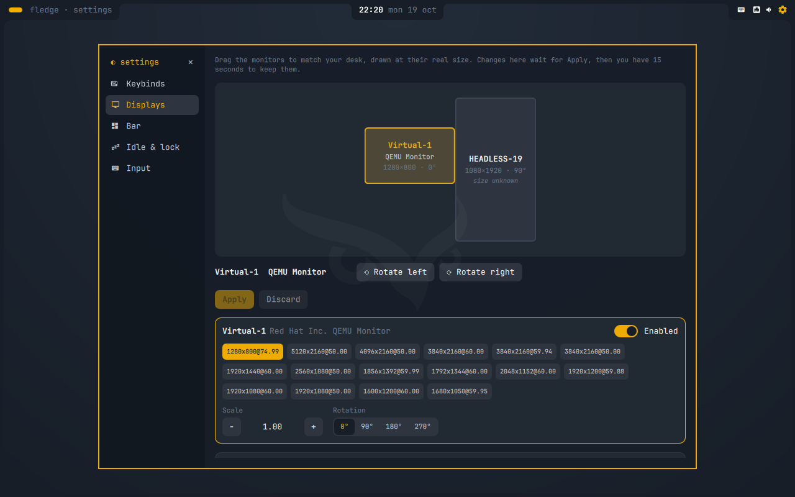

# fledge

*by made by moonlight*

A CachyOS + Hyprland desktop and the installer ISO that puts it on a machine:
boot the ISO, answer a few questions in its graphical installer, and
it installs unattended onto an encrypted btrfs disk, desktop included, then
reboots to the login screen.

The desktop is its own Quickshell shell (`fledge`): an attached bar with three
hanging tabs inside a rounded screen frame, a launcher (apps, clipboard,
emoji, system), notifications, OSD, lock screen, quick settings and a
settings window. Settings are one JSON file that generates the Hyprland
config. Hyprland runs a Lua config and doesn't reload on its own: after
hand-editing `~/.config/hypr`, run `hyprctl reload`. Pinning workspaces to
monitors is edited on the Displays page of the settings window, which also
arranges the screens: drag them on a canvas drawn at their real size (they
snap to each other, can rotate left or right, can't overlap, and each must
touch another), switch one off from its card and back on from the chip under
the canvas, and one Apply sets every screen's position, rotation, mode and
scale together, with 15 seconds to Keep it before it reverts. Screens are
remembered by description, so a layout follows the monitor to another port.
Wallpapers live in `~/Pictures/Wallpapers` and are chosen (per monitor if you
like) on the Displays page. Audio is PipeWire (wireplumber, pipewire-pulse),
and the desktop ships an emoji font for the emoji picker.

## Install

Download the ISO and its `.sha256` from the
[latest release](https://github.com/Made-by-Moonlight/fledge/releases/latest),
check it, and write it to a USB stick (or copy it onto a Ventoy stick):

    sha256sum -c fledge-*.iso.sha256
    sudo dd if=fledge-*.iso of=/dev/sdX bs=4M status=progress oflag=sync

Secure Boot must be off. The install needs an internet connection; the
installer can join Wi-Fi, and the network carries over to the installed system.
With several screens, the installer opens on one and the others show the owl;
if it opened on a screen you can't read (one mounted on its side shows
sideways until it's set up), click Install on this screen on another, or press
Ctrl+M to move it to the next one.

## Upgrade

An installed system keeps the repo in `~/proj/fledge`, stowed into `~`:

    git -C ~/proj/fledge pull && bash ~/proj/fledge/cachyos/bootstrap.sh

Installs made before the fledge rename (any install whose repo isn't at
`~/proj/fledge`) can't upgrade in place: back up your files and reinstall
from the ISO. Nothing migrates them.

## Screenshots

| | |
|---|---|
|  |  |
| The graphical installer | Review: everything asked up front, then unattended |
|  |  |
| Disk unlock (Plymouth) | Login (SDDM) |
|  |  |
| Desktop: bar tabs and screen frame | Launcher (apps, clipboard, emoji, system) |
|  |  |
| Lock screen | Quick settings |
|  |  |
| Settings (keybinds, displays, bar, idle, input) | Displays: arrange screens at their real size, rotated or not |

## Repo layout

- `cachyos/iso/` — the installer ISO and its graphical installer (build, test, release)
- `cachyos/install/` — the installer itself and first-boot setup
- `cachyos/bootstrap.sh` — the desktop layer, run by the installer (or on first boot if that failed)
- `cachyos/branding/` — owl, palette and theme assets
- `dot-config/quickshell/fledge/` — the desktop shell (bar, launcher, notifications, lock, settings)
- `dot-config/hypr/` — the Hyprland config: `hyprland.lua` and its `fledge/*.lua` modules
- `dot-local/share/fledge/` — the `fledge` command: `fledge <group> <action>` over the scripts in `libexec/`, `fledge settings` (defaults + overrides → generated Hyprland Lua), `fledge hypr`, `fledge dmenu`
- `dot-config/`, `dot-local/` — dotfiles, stowed into `~` (`.stow-local-ignore` keeps the rest of the repo out)

The repo is [github.com/Made-by-Moonlight/fledge](https://github.com/Made-by-Moonlight/fledge).
Releases are built by GitHub Actions when a `v*` tag is pushed on `main`
(see `cachyos/iso/README.md`).
