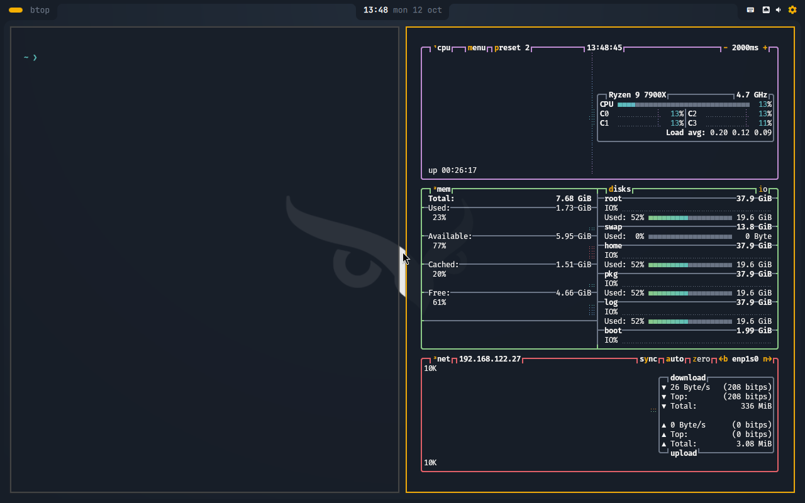
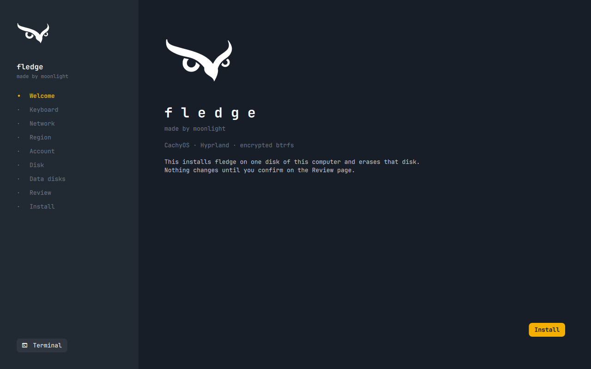
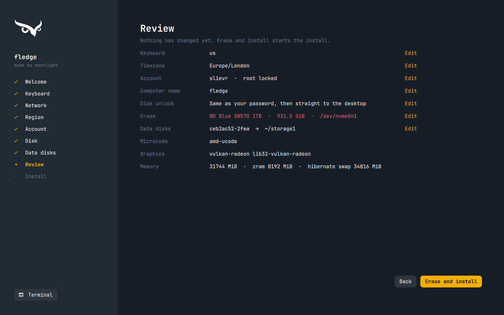
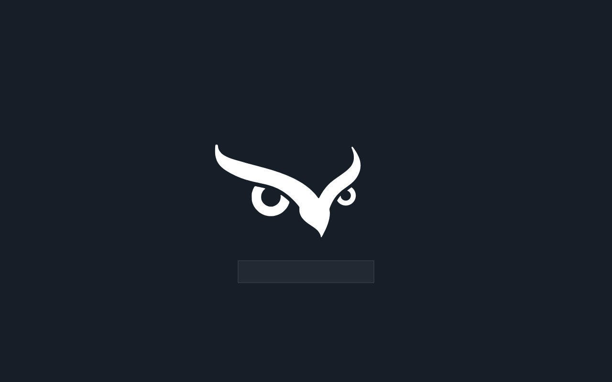
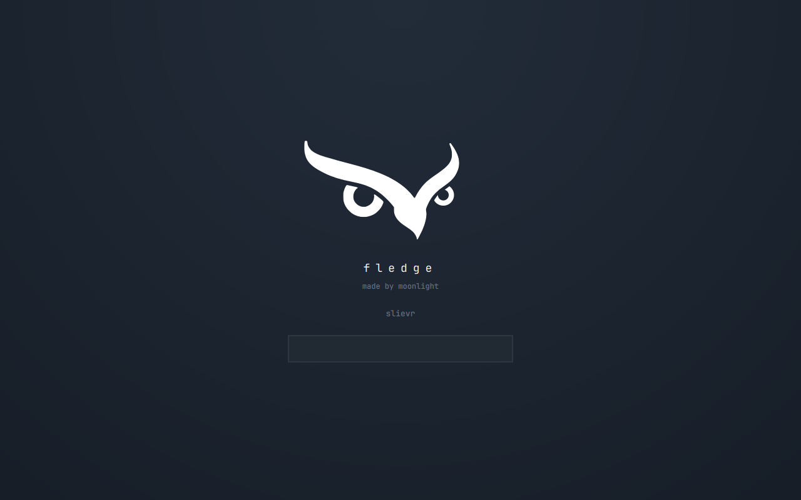
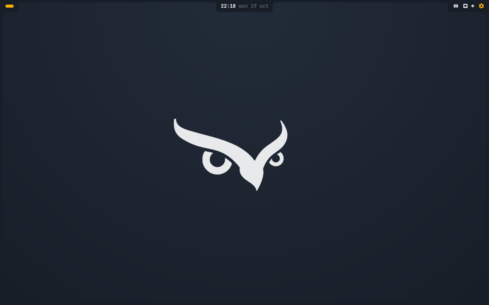
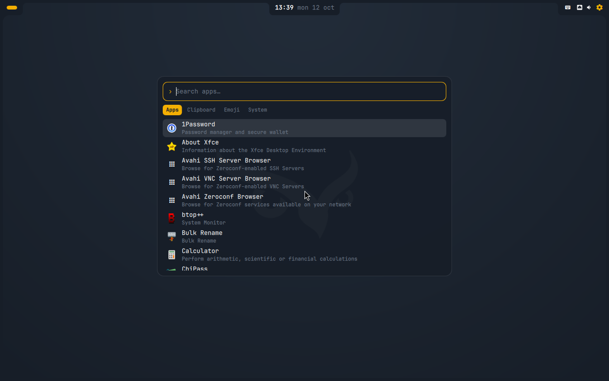
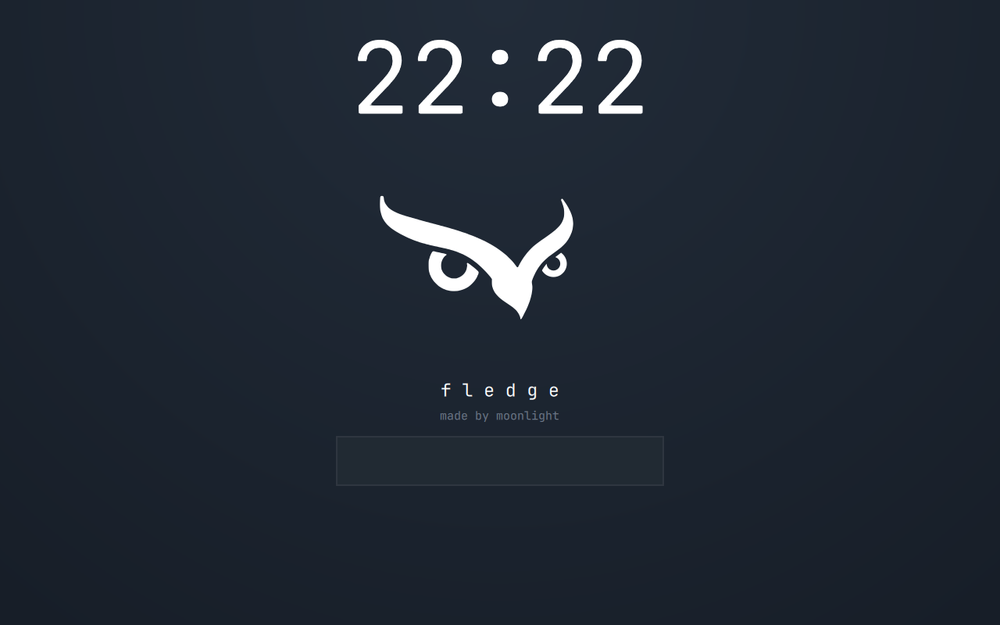
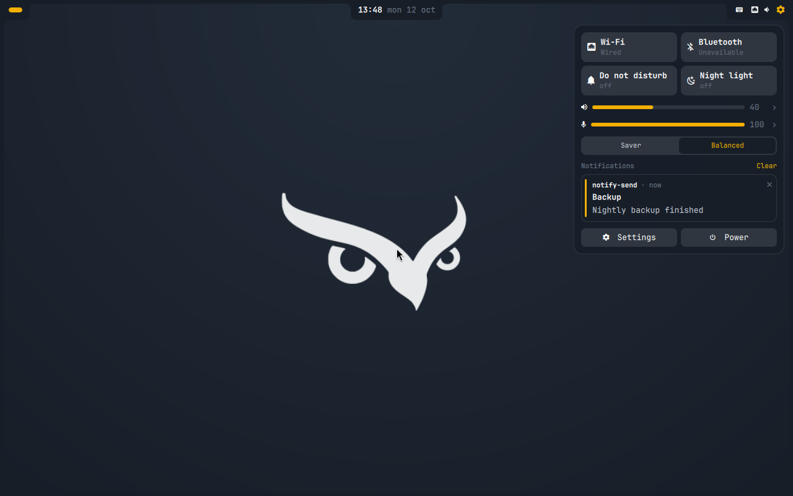
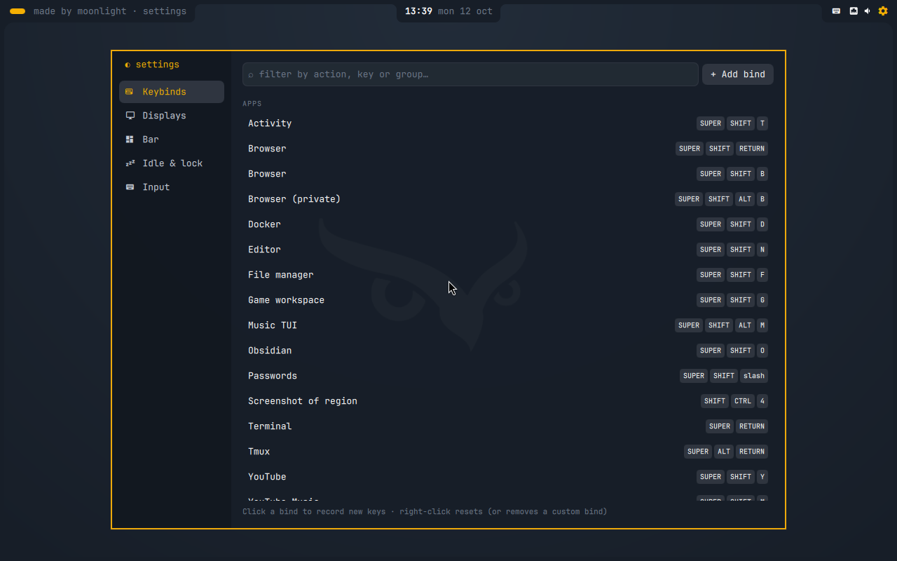

# made by moonlight

A CachyOS + Hyprland desktop and the installer ISO that puts it on a machine:
boot the ISO (fledge), answer a few questions in its graphical installer, and
it installs unattended onto an encrypted btrfs disk, desktop included, then
reboots to the login screen.

The desktop is its own Quickshell shell (`mbm`): an attached bar with three
hanging tabs inside a rounded screen frame, a launcher (apps, clipboard,
emoji, system), notifications, OSD, lock screen, quick settings and a
settings window. Settings are one JSON file that generates the Hyprland
config (Hyprland runs a Lua config; after hand-editing `~/.config/hypr`,
run `hyprctl reload`, as Hyprland doesn't reload on its own); pinning workspaces to monitors is edited on the Displays page of the
settings window. Wallpapers live in `~/Pictures/Wallpapers` and are chosen
(per monitor if you like) on the Displays page. Audio is PipeWire (wireplumber, pipewire-pulse), and the
desktop ships an emoji font for the emoji picker.

## Install

Download the ISO and its `.sha256` from the
[latest release](https://github.com/slievr/slievr-cachy/releases/latest),
check it, and write it to a USB stick (or copy it onto a Ventoy stick):

    sha256sum -c fledge-*.iso.sha256
    sudo dd if=fledge-*.iso of=/dev/sdX bs=4M status=progress oflag=sync

Secure Boot must be off. The install needs an internet connection; the
installer can join Wi-Fi, and the network carries over to the installed system.

## Screenshots

| | |
|---|---|
|  |  |
| The installer | Everything asked up front, then unattended |
|  |  |
| Disk unlock (Plymouth) | Login (SDDM) |
|  |  |
| Desktop: bar tabs and screen frame | Launcher (apps, clipboard, emoji, system) |
|  |  |
| Lock screen | Quick settings |
|  | |
| Settings (keybinds, displays, bar, idle, input) | |

## Repo layout

- `cachyos/iso/` — the installer ISO and its graphical installer (build, test, release)
- `cachyos/install/` — the installer itself and first-boot setup
- `cachyos/bootstrap.sh` — the desktop layer, run by the installer (or on first boot if that failed)
- `cachyos/branding/` — owl, palette and theme assets
- `dot-config/quickshell/mbm/` — the desktop shell (bar, launcher, notifications, lock, settings)
- `dot-config/hypr/` — the Hyprland config: `hyprland.lua` and its `fledge/*.lua` modules
- `dot-local/share/mbm/` — the `mbm` CLI: settings (defaults + overrides → generated Hyprland Lua), dmenu
- `dot-local/share/fledge/` — the `fledge` CLI: `fledge hypr dispatch|set|eval|quote`, the one way scripts talk to Hyprland
- `dot-config/`, `dot-local/` — dotfiles, stowed into `~`

Releases are built by GitHub Actions when a `v*` tag is pushed on `main`
(see `cachyos/iso/README.md`).
